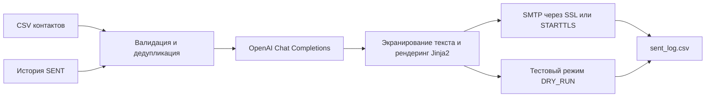

# Внедрение автономной системы AI-аутрича с гиперперсонализацией и защитой от спама

| Параметр | Описание |
| --- | --- |
| Проект | **Smart Outreach AI** |
| Отрасль / ниша | B2B-продажи, IT-услуги, аутрич-маркетинг |
| Роль | AI-разработчик / инженер автоматизации процессов |
| Стек | Python 3.10+, OpenAI API (`gpt-4o-mini`, JSON mode), `smtplib`, `email.policy.SMTP`, Jinja2, pandas, Tenacity, Pydantic v2, pydantic-settings, tqdm |
| Статус | Реализован CLI для пилота. Бизнес-показатели приведены как оценки и цели. |

## 1. Бизнес-контекст и исходный процесс (AS-IS)

SDR вручную определяет лицо, принимающее решение, изучает его роль и компанию, фиксирует повод для обращения в таблице и адаптирует шаблон письма. После отправки сотрудник обновляет статус контакта. Качество персонализации и учёта зависит от того, сколько времени сотрудник может выделить на каждую запись.

| Узкое место | Последствие для команды |
| --- | --- |
| 15–25 минут на вдумчивое B2B-письмо | Верхний ориентир исходного сценария — 20–25 контактов в день на SDR при работе ближе к нижней границе времени на письмо. |
| Шаблон «Здравствуйте, %name%» с подстановкой имени | Письмо редко объясняет, почему предложение относится к задачам конкретного адресата. Исходное допущение для шаблонных кампаний — Reply Rate около 1,5–2%. |
| Залповые отправки без пауз | Всплески нагрузки могут вызвать ограничения со стороны почтового провайдера и ухудшить репутацию отправителя. |
| Ручное редактирование писем и статусов | Возникают дубли, ошибки в именах и перенос контекста от другого контакта. |

## 2. Решение и архитектура (TO-BE)

Smart Outreach AI обрабатывает подготовленный CSV последовательно. SDR отвечает за выбор аудитории и достоверность исходного контекста. CLI берёт на себя проверку базы, генерацию текста, оформление письма, отправку и запись результата.

### Подготовка базы и конфигурация

- **Входные данные.** pandas читает CSV с обязательной колонкой `email`. CLI удаляет пробелы по краям полей и проверяет синтаксис адреса регулярным выражением. Для сравнения адресов используется `casefold()`. Дубликаты в текущем файле и адреса с историческим статусом `SENT` исключаются до применения `--limit`. [Точка входа CLI](main.py)
- **Настройки.** pydantic-settings загружает переменные окружения и локальный `.env`. Pydantic проверяет обязательные поля, HTTP(S)-адрес шлюза OpenAI, границы SMTP-порта и диапазон задержек. Ключ API и пароль SMTP представлены типом `SecretStr`. [Конфигурация](config.py)

### AI-персонализация

`EmailPersonalizer` отправляет в Chat Completions имя, компанию, роль и `context_note`. Системный промпт просит связать повод для обращения с задачами адресата, сформулировать короткую тему и завершить письмо простым следующим шагом. Модель получает инструкцию опираться на переданные факты и избегать выдуманных сведений об адресате, отправителе и предложении. Достоверность утверждений по внешним источникам требует отдельной проверки.

API вызывается в режиме `json_object`. Код проверяет завершённость ответа, разбирает JSON и валидирует непустые строки `subject` и `body`. Tenacity выполняет до трёх попыток с экспоненциальной задержкой и случайным разбросом при проблемах соединения, HTTP 408, 409, 429 и 5xx. При исчерпании попыток или ошибке ответа CLI фиксирует `AI_ERROR` и продолжает обработку базы. [Генератор](ai_generator.py) · [Цикл обработки](main.py)

### Формирование письма и доставка

CLI разбивает текст на абзацы и экранирует их через `html.escape()`. Jinja2 добавляет приветствие и подпись. Шаблон предусматривает необязательные ссылки на отписку и контакты. SMTP-модуль собирает письмо `multipart/alternative` с UTF-8-заголовками и двумя частями — `text/plain` и `text/html`. На порту 465 используется SMTP over SSL, на остальных — STARTTLS перед аутентификацией. [Точка входа CLI](main.py) · [Шаблон письма](templates/email_template.html) · [SMTP-модуль](mailer.py)

### Повторный запуск, журнал и контроль отправки

- **Идемпотентность по журналу.** После обработки каждого контакта CLI открывает `data/sent_log.csv` в режиме дозаписи, записывает результат и закрывает файл. При следующем запуске адреса со статусом `SENT` исключаются. Статусы `DRY_RUN`, `AI_ERROR`, `TEMPLATE_ERROR` и `SMTP_ERROR` оставляют контакт доступным для повторной обработки. CSV не обеспечивает атомарную транзакцию с SMTP. Если сервер принял письмо, а процесс завершился до записи `SENT`, при повторном запуске возможен дубль. Параллельная обработка потребует общей очереди и блокировок. [Журнал и цикл CLI](main.py)
- **Темп отправки.** Между SMTP-попытками CLI делает случайную паузу в пределах 3–7 секунд по умолчанию. Это сглаживает залповые отправки в одном запуске. Для коммерческого пилота лимиты кампании и правила обработки отписок задаются отдельно. [Цикл CLI](main.py) · [SMTP-модуль](mailer.py)
- **Pre-flight.** Флаг `--dry-run` выполняет генерацию и рендеринг без SMTP и записывает статус `DRY_RUN`. В сочетании с `--limit` он позволяет проверить конфигурацию и работу конвейера на небольшой выборке. CSV содержит тему и статус. Просмотр полного HTML-письма потребует отдельного вывода результата рендеринга. [Точка входа CLI](main.py)

## 3. Бизнес-результаты и метрики пилота

Значения в таблице описывают расчётный сценарий. Для него база уже подготовлена, а затраты на ресерч и сопровождение кампании учитываются отдельно. Фактических замеров на коммерческой кампании пока нет.

| Метрика | Было · ручной процесс | Стало · оценка или цель пилота | Как измерить |
| --- | --- | --- | --- |
| Время обработки 100 контактов | Около 25 рабочих часов SDR при 15 минутах на контакт | 12–15 минут работы скрипта на готовой базе | Замерить время от запуска до записи последней строки, включая ответы API, SMTP и паузы. |
| Себестоимость обработки контакта | 350–500 ₽ трудозатрат специалиста | 0,4–0,8 ₽ прямых расходов на OpenAI и SMTP | Разделить фактические расходы на API и SMTP на число обработанных контактов. Ресерч, проверку и сопровождение учесть отдельно. |
| Пропускная способность команды | Ориентир 20–25 контактов в день на SDR | Целевой рост в 10–15 раз при том же штате | Сравнить число обработанных валидных контактов за одинаковый период с учётом доступной базы и лимитов отправки. |
| Reply Rate | Исходное допущение 1,5–2% | Прогноз 6–9% за счёт привязки обращения к роли и контексту | Сравнить сопоставимые сегменты в A/B-пилоте. Считать долю уникальных получателей, ответивших в заданное окно, среди доставленных писем. |
| Delivery Rate / Inbox Placement | Базовые значения предстоит измерить | 98%+ — целевой ориентир Delivery Rate. Inbox Placement измеряется отдельно. | Сверить события доставки и возвраты у провайдера. Попадание во входящие проверить на тестовых ящиках. Статус `SENT` отражает приём сообщения SMTP-сервером. |

При обработке 100 контактов средняя пауза в 5 секунд даёт около 8 минут 15 секунд ожидания на 99 интервалах. Чтобы уложиться в 12–15 минут, суммарное время вызовов API, SMTP и рендеринга должно составить ещё примерно 4–7 минут. Повторные попытки и задержки провайдера увеличивают длительность прогона.

## 4. Экономический эффект и масштабирование

В сценарии на 100 контактов ручная обработка стоит **35–50 тыс. ₽**, а прямые расходы автоматизированного прогона составляют **40–80 ₽**. Разница описывает потенциал экономии на подготовке и отправке. Реализуемый эффект зависит от доли времени SDR, которую команда действительно высвободит и направит на квалификацию ответов и переговоры.

Для расчёта ROI пилота к стоимости высвобождённых часов добавляется дополнительная валовая прибыль от сделок, подтверждённая сравнением кампаний. Из этой суммы вычитаются затраты на внедрение и эксплуатацию. Полученный эффект делится на затраты за тот же период. При расчёте эксплуатационных затрат учитываются подготовка базы, контроль качества, API, почтовая инфраструктура и сопровождение.

| Направление развития | Что добавить |
| --- | --- |
| Интеграция с Bitrix24 и amoCRM | Передавать контакты и события через вебхуки, записывать результат в карточку CRM, синхронизировать списки исключений и учитывать повторную доставку вебхуков. |
| Управление несколькими почтовыми ящиками | Закреплять ящик за кампанией или сегментом, вводить лимиты на ящик и домен и постепенно наращивать допустимую нагрузку при warm-up. Поддерживать общий список отписок и исключений для всех ящиков. |
| Разбор входящих ответов через LLM | Связывать ответ с контактом и кампанией, выделять интерес, отказ, запрос на отписку и автоответ. Направлять неоднозначные ответы на ручную проверку. |
| Надёжная обработка очереди | Перенести журнал заданий в БД, ввести уникальный ключ кампании и получателя, сохранять переходы между статусами и сверять неоднозначные отправки с событиями провайдера перед повтором. |

Критерии перехода от пилота к масштабированию — измеренная стоимость обработки, рост доли содержательных ответов в сопоставимых сегментах и стабильная доставляемость по данным почтового провайдера.
