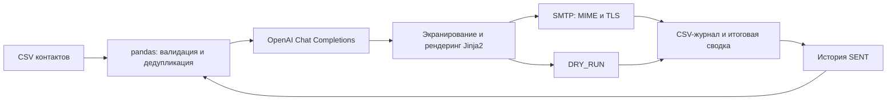

# Smart Outreach AI — CLI-система массовой email-рассылки с AI-персонализацией и аналитикой доставки


Отказоустойчивый CLI-конвейер для прямых B2B-рассылок и аутрич-кампаний. Он проверяет CSV-базу, формирует индивидуальные письма через LLM с учётом роли и контекста адресата, отправляет их через SMTP и ведёт журнал результатов. Конвейер готов к пилотному запуску на подготовленной базе.

Полный бизнес-кейс описывает исходный процесс SDR, расчёт окупаемости (ROI), оценку скорости обработки и методику замера конверсии воронки. [CASE_STUDY.md](./CASE_STUDY.md)

## Ключевые возможности

- **AI-персонализация.** OpenAI Chat Completions с `gpt-4o-mini` в режиме JSON Mode (`json_object`). Приложение проверяет поля `subject` и `body`. Промпт ограничивает модель фактами из роли и `context_note`, чтобы снизить риск выдуманных деталей.
- **HTML и plain text.** Экранированный текст превращается в абзацы адаптивного Jinja2-шаблона. Письмо отправляется в формате MIME `multipart/alternative` с HTML-версией и автоматически сформированной текстовой частью.
- **Контроль темпа и TLS.** Между SMTP-попытками действует случайная пауза 3–7 секунд. На порту 465 используется SMTP over SSL, на стандартном для проекта порту 587 — STARTTLS.
- **Повторный запуск и обработка сбоев.** CLI убирает дубли из входной базы и пропускает адреса со статусом `SENT` в `data/sent_log.csv`. Tenacity выполняет до трёх попыток при временных сетевых сбоях и ответах API 408, 409, 429 и 5xx.
- **Тестовый режим.** `--dry-run` запускает генерацию и рендеринг без SMTP. В журнал записывается `DRY_RUN`. Режим вызывает OpenAI API и может расходовать токены.
- **Сводка по рассылке.** CLI показывает число обработанных, пропущенных и ошибочных записей. Статус `SENT` означает, что SMTP-сервер принял письмо. Фактическую доставку и попадание во входящие измеряют по данным почтового провайдера.

## Архитектура



Журнал дополняется после каждого контакта. Если процесс завершится после приёма письма SMTP-сервером и до записи `SENT`, при следующем запуске возможен повтор. Сетевые и SMTP-ошибки записываются в `mailer.log`.

## Быстрый старт

Требуются Python 3.10+, ключ OpenAI API и параметры SMTP.

### 1. Клонировать проект и установить зависимости

```powershell
git clone https://github.com/alex-hash986/Email_sender_auto.git
cd Email_sender_auto
python -m venv .venv
.\.venv\Scripts\Activate.ps1
python -m pip install -r requirements.txt
Copy-Item .env.example .env
```

В Bash виртуальное окружение активируется командой `source .venv/bin/activate`. Для копирования конфигурации используйте `cp .env.example .env`.

### 2. Заполнить конфигурацию и CSV

В `.env` укажите `OPENAI_API_KEY`, `SMTP_SERVER`, `SMTP_PORT`, `SMTP_USERNAME`, `SMTP_PASSWORD`, `SENDER_EMAIL` и `SENDER_NAME`. Пустой `OPENAI_BASE_URL` оставляет стандартный адрес API. Значения модели и задержек уже заданы в [примере конфигурации](./.env.example). SMTP-поля проверяются и в тестовом режиме.

Обязательная колонка CSV — `email`. Для персонализации добавьте `name`, `company`, `role` и `context_note`. Пример структуры находится в [data/contacts_example.csv](./data/contacts_example.csv).

### 3. Выполнить тестовый прогон и отправку

```powershell
python main.py --csv data/contacts_example.csv --dry-run --limit 3
python main.py --csv data/contacts.csv --limit 10
```

Для второй команды подготовьте собственный `data/contacts.csv` с адресатами кампании. Лимит применяется после проверки адресов, исключения дублей и сверки с журналом `SENT`. Результаты прогона доступны в `data/sent_log.csv`, диагностические сообщения — в `mailer.log`.

## Комплаенс и персональные данные

Оператор кампании определяет применимые требования к обработке персональных данных и отправке рекламы. До запуска установите правовое основание, проверьте требования к предварительному согласию и обеспечьте обработку отписок и возражений. Для РФ учитывайте ст. 15 152-ФЗ и, для рекламных сообщений, применимость ст. 18 38-ФЗ. При применимости GDPR учитывайте ст. 6 и 21 и местные правила электронного маркетинга. [152-ФЗ](https://rosguard.gov.ru/document/article/federalnyj-zakon-ot-27-iyulya-2006-g--152fz) · [GDPR](https://eur-lex.europa.eu/eli/reg/2016/679/oj)

В запрос к модели передаются имя, компания, роль и `context_note`. Ограничьте содержимое этих полей необходимым для персонализации контекстом. Проверьте условия передачи данных внешнему API и задайте срок хранения CSV и журналов. Журнал отправок и паузы управляют работой CLI. Согласия и список исключений ведёт оператор кампании.

## Лицензия

MIT указана как планируемая лицензия. Текст лицензии пока отсутствует в репозитории.
