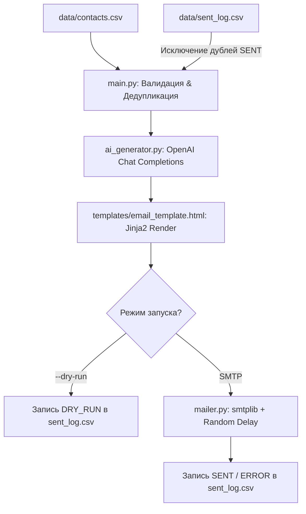

# Smart Outreach AI — Автоматизированная система рассылки с AI-персонализацией


Отказоустойчивый CLI-конвейер для массовой отправки гиперперсонализированных B2B-писем. Решение автоматизирует рутину SDR и email-маркетологов: валидирует базу контактов, с помощью LLM генерирует уникальный оффер под контекст и роль адресата, собирает адаптивный HTML с plain-text версией и безопасно доставляет письма через SMTP с защитой от спам-фильтров.

> 📊 **Бизнес-кейс и окупаемость (ROI):**  
> Подробный расчет экономики проекта, сравнение метрик «Было / Стало» и анализ рисков представлены в документе [CASE_STUDY.md](./CASE_STUDY.md).

---

## 🎯 Бизнес-задачи и ценность

- **Гиперперсонализация вместо шаблонного спама:** генерация индивидуальной темы и текста письма на основе роли контакта и вводных заметок (`context_note`).
- **Сокращение рутины:** ускорение подготовки кампании со ~15–20 минут на письмо вручную до 12–15 минут на всю базу из 100 контактов.
- **Снижение затрат:** прямая себестоимость обработки контакта снижается с 350–500 ₽ (оплата труда) до ~0.4–0.8 ₽ (расходы на API/SMTP).
- **Защита репутации домена:** динамические интервалы между отправками и поддержка multipart MIME снижают риск попадания в спам.

---

## 🛠 Ключевые технические особенности

- **Гарантированная структура (JSON Mode):** вызовы к OpenAI выполняются с `response_format={"type": "json_object"}`. Модель строго возвращает тему (`subject`) и тело письма (`body`) без галлюцинаций.
- **Отказоустойчивость вызовов (Tenacity):** автоматический повтор запросов при временных сбоях сети или лимитах (HTTP 408, 409, 429, 5xx) с экспоненциальной задержкой.
- **Корректные почтовые стандарты:** формирование писем по стандарту `multipart/alternative` (`email.policy.SMTP`). Скрипт автоматически парсит HTML и генерирует чистую текстовую версию (plain-text fallback).
- **SSL / STARTTLS:** автоматический выбор шифрования (SSL на порту 465, STARTTLS на порту 587 и остальных).
- **Идемпотентность и защита от дублей:** контакты со статусом `SENT` в `data/sent_log.csv` автоматически пропускаются при повторных запусках. Запись в лог ведется потоково (append-mode).
- **Безопасный режим (`--dry-run`):** полный прогон генерации и сборки HTML без реальной отправки в сеть.

---

## 🏗 Архитектура решения



```text
Email_sender_auto/
├── data/
│   ├── contacts_example.csv    # Демонстрационная база лидов
│   └── sent_log.csv            # Журнал отправки (создается автоматически)
├── templates/
│   └── email_template.html     # Адаптивный B2B HTML-шаблон (Jinja2)
├── .env.example                # Шаблон переменных окружения
├── .gitignore                  # Исключения секретов и логов
├── ai_generator.py             # Генератор контента через OpenAI API
├── config.py                   # Pydantic v2 Settings (валидация параметров)
├── mailer.py                   # SMTP-клиент с поддержкой MIME и рандомных пауз
├── main.py                     # CLI точка входа, валидация и прогресс-бар
├── requirements.txt            # Зависимости проекта
├── CASE_STUDY.md               # Подробный бизнес-кейс с метриками и ROI
└── README.md                   # Документация проекта

```
```bash
git clone https://github.com/alex-hash986/Email_sender_auto.git
cd Email_sender_auto

# Создание и активация виртуального окружения
python -m venv .venv

# Windows:
.venv\Scripts\activate
# Linux/macOS:
# source .venv/bin/activate

# Установка зависимостей
pip install -r requirements.txt

```
Скопируйте шаблон .env.example в .env:
```bash
copy .env.example .env   # Windows
# cp .env.example .env    # Linux/macOS

```
Заполните обязательные параметры в файле .env:
```ini
OPENAI_API_KEY="sk-..."
OPENAI_MODEL="gpt-4o-mini"
OPENAI_BASE_URL="" # Опционально, при использовании прокси

SMTP_SERVER="smtp.gmail.com"
SMTP_PORT=587
SMTP_USERNAME="your-email@gmail.com"
SMTP_PASSWORD="your-app-password"
SENDER_EMAIL="your-email@gmail.com"
SENDER_NAME="Алексей"

DELAY_MIN_SECONDS=3.0
DELAY_MAX_SECONDS=7.0

```
Проверяет валидацию, генерирует тексты через AI и рендерит HTML без отправки по SMTP:
```bash
python main.py --dry-run --limit 2

```
Отправка писем по базе с рандомизированными паузами и записью результатов:
```bash
python main.py --csv data/contacts_example.csv --limit 10

```
- --csv — путь к CSV-файлу с контактами (по умолчанию data/contacts_example.csv).
- --dry-run — тестовый режим без вызова SMTP.
- --limit — ограничение на количество обрабатываемых контактов за запуск.
- Секретные данные (API-ключи, пароли SMTP) типизированы через pydantic.SecretStr и никогда не попадают в логи.
- Все персональные данные адресатов обрабатываются локально и не сохраняются на сторонних серверах, кроме контекстных вызовов LLM.
- Решение предназначено для отправки сообщений контактам, давшим согласие на получение информации (в соответствии с 152-ФЗ / GDPR).
Алексей Ханипов

AI-разработчик / Инженер автоматизации процессов
- GitHub: [@alex-hash986](https://github.com/alex-hash986)
